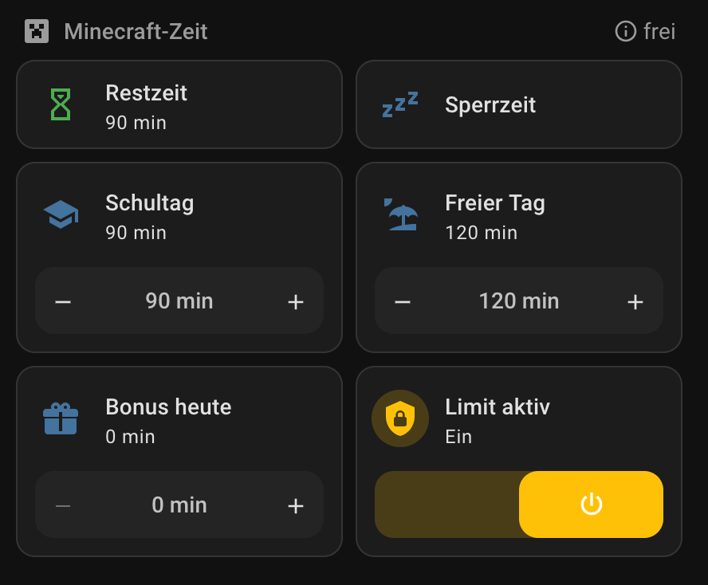

# minertimer

**Daily time limit for Minecraft Java Edition on macOS** – works no matter how the game is launched: CurseForge, the official launcher, Prism and others.

macOS Screen Time cannot limit Minecraft Java Edition, because the game runs as a Java process ([long-standing issue](https://bugs.mojang.com/browse/MCL-14705)). minertimer fills that gap. It is a small background service that runs as root, so a child without administrator rights cannot switch it off.

Deutsche Anleitung: [README.de.md](README.de.md)

## Features

- **Counts real play time only.** A second counts when Minecraft is running, one of the child's accounts is the one in front of the screen, and there was mouse or keyboard input in the last 3 minutes. A game left open in the background, a sleeping Mac or another logged-in user does not use up time.
- **Detects only the game.** It recognises the Minecraft client (vanilla, Forge, NeoForge, Fabric, Quilt). Other Java programs such as IDEs, build tools or a local server are left alone.
- **Warns before the end.** At 10, 5 and 1 minutes left, the child gets a notification and a spoken announcement. When the game starts, a notification shows how much time is left today.
- **Quits in two steps.** When time is up, Minecraft is first asked to quit and force-quit 20 seconds later. Starting it again closes it right away.
- **Flexible limits.** You set separate limits for school days and free days (weekends plus holidays you list). An optional curfew, such as `20:30-07:00`, blocks playing completely.
- **Per child, not per account.** With `accounts = *`, Minecraft in any non-administrator account counts towards the child's limit, including accounts added later. A second account no longer gets around the limit. You can also list accounts one by one (`accounts = emma, emma2`).
- **Several children and Macs.** Add one `[user …]` section per child and install it on each Mac.
- **German or English.** Notifications, announcements and Home Assistant entity names follow the Mac's system language, or a fixed `language = de|en`.
- **Optional Home Assistant integration.** It connects via MQTT discovery. Home Assistant then shows play time, remaining time and status. You can change the limits, give a bonus, stop the game immediately, set the curfew and switch the limit on or off. **Without Home Assistant everything works the same**, configured by a file.
- **Tamper-resistant.** The program, configuration and counters belong to root. The counters survive restarts, and the service restarts itself if it crashes.
- **Logs what happens.** Game start and end, warnings and quits are written to `/var/log/minertimer.log`.

## Requirements

- macOS with the **Command Line Tools**, which provide `/usr/bin/python3`. Install them with `xcode-select --install` if they are missing. No other dependencies.
- An administrator account for installing.
- The child uses a **standard account**, not an administrator account.
- Optional: an MQTT broker, such as the Mosquitto app in Home Assistant.

Tested on macOS 15 (Intel) with Minecraft 1.21 via CurseForge/Forge. Feedback from other setups is welcome.

## Installation

As an administrator (not as the child), in Terminal:

```sh
git clone https://github.com/dieoma76/minertimer.git ~/minertimer
cd ~/minertimer
sudo zsh install.sh
```

On the first install the script asks for:
- the account to limit
- the minutes for school days and free days
- the language
- optionally the MQTT connection (the password is entered hidden and is only stored in the root-protected configuration)

To update, run `git pull` and then `sudo zsh install.sh` again. Your configuration is kept.

**Important:** never install from a folder the child can modify, such as their `Public` folder or a Homebrew installation they own. The script runs as root.

## Usage

| What | Command |
|---|---|
| Change settings | `sudo vi "/Library/Application Support/minertimer/minertimer.conf"` (applied automatically) |
| Today's state | `sudo /usr/bin/python3 "/Library/Application Support/minertimer/minertimer.py" --status` |
| Log | `tail -f /var/log/minertimer.log` |
| Is the service running? | `sudo launchctl print system/de.dieoma76.minertimer \| grep state` |
| Remove | `sudo zsh uninstall.sh` (`--keep-config` keeps settings and counters) |

All options are explained in [`minertimer.conf.example`](minertimer.conf.example).

## Home Assistant (optional)

1. Create a user for minertimer: Settings → People → Users. It should not be an administrator, and it should only be allowed to log in from the local network. The Mosquitto app accepts Home Assistant users without further setup. With another broker, create an MQTT user there.
2. Answer "y" to the MQTT question in `install.sh` and enter the broker, user and password. Or set the `[mqtt]` section in the configuration later.
3. A device **"Minertimer &lt;computer name&gt;"** appears with these entities for each child:

| Entity | Type |
|---|---|
| Played today, Remaining today, Allowed today, Status | sensors |
| Playing in account | sensor: the macOS account Minecraft is running in, otherwise `-` |
| Playing now | binary sensor |
| Limit school day, Limit free day | number (configuration) |
| Bonus today | number, reset at midnight |
| +15 min bonus | button |
| Stop now | button: quits Minecraft immediately and forfeits today's remaining time. A bonus afterwards grants exactly those minutes. |
| Limit active | switch (off = only count) |
| Curfew | text `HH:MM-HH:MM`, empty = none |

Example dashboard (German UI) with the entities as tiles:



Values changed in Home Assistant stay in effect until the same value is changed in the configuration file. Then the file wins again. If Home Assistant or the broker is unreachable, the limit keeps working with the last known values.

MQTT topics:
- state: `minertimer/<mac>/<child>/state` (JSON, retained)
- commands: `minertimer/<mac>/<child>/set/<field>`
- availability: `minertimer/<mac>/status`

## Limits

minertimer is a parental tool, not a security product. It does **not** help if:
- the child has an administrator account
- the child plays in an administrator account or an account in `exempt_users` (Minecraft in accounts that are not limited is logged as a warning)
- without `accounts = *`, the child plays in an account that is not listed in `accounts`
- the child plays in a browser (clones such as Eaglercraft are not a Java process)
- the child plays on a different device

## Background

minertimer started as a fork of [soferio/minertimer](https://github.com/soferio/minertimer) and was rewritten from scratch, because the original:
1. counted time whenever any process called "java" existed, for all users and even while the Mac slept. A game left open overnight used up the next day's budget.
2. quit every Java program, not only Minecraft.
3. sent warnings from the root service, so they never reached the child's session.
4. only sent SIGTERM, so a hanging game kept running.
5. had no log and did not restart after a crash.
6. could leave its script and log folders writable by everyone, depending on the installation, so the child could replace the root script.

## Tests

```sh
python3 -m unittest discover -s tests
```

The tests simulate system, clock and users, so they also run on Linux.

## License

MIT, like the original. Copyright 2024 Soferio Pty Limited for the original idea. See [`LICENSE`](LICENSE).
